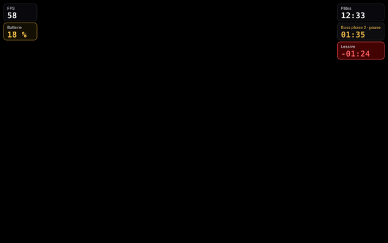

# Decky Overlay – plugin Decky Loader

Un overlay en jeu **partagé** par plusieurs plugins Decky sur le Steam Deck.



## Pourquoi

gamescope n'affiche qu'**une seule** fenêtre d'overlay externe à la fois (marquée `GAMESCOPE_EXTERNAL_OVERLAY`). Deux plugins qui ouvrent chacun la leur se gênent : un seul s'affiche. Decky Overlay possède cette fenêtre unique, et les autres plugins lui envoient ce qu'ils veulent afficher.

## Installation

Decky › Paramètres › Développeur › Installer un plugin depuis une URL :

```
https://github.com/powange/decky-overlay/releases/latest/download/decky-overlay.zip
```

Les plugins compatibles (comme [Decky Timer](https://github.com/powange/decky-timer)) proposent de l'installer automatiquement s'il manque. Les mises à jour se font ensuite avec le bouton **Mises à jour** du plugin.

## Réglages

- Afficher ou masquer l'overlay, taille, opacité du fond, aperçu de 10 s.
- **Plugins connectés** : masquer les éléments d'un plugin sans le désinstaller.
- L'overlay ne s'affiche qu'en mode jeu, jamais sur le bureau.

## Pour les auteurs de plugins : le protocole

Socket Unix `/tmp/decky-overlay/overlay.sock`, messages JSON, un par ligne (UTF-8, 64 Ko max). Protocole version 1.

```jsonc
// 1. Se présenter (obligatoire, une fois par connexion)
{"op": "hello", "client": "mon-plugin", "name": "Mon Plugin", "protocol": 1}
// <- {"op": "welcome", "protocol": 1, "zones": ["top-left", "top-center", "top-right", "bottom-left", "bottom-right"]}

// 2. Créer ou remplacer un bloc (jusqu'à 8 blocs par plugin, 12 éléments par bloc)
{"op": "set", "id": "principal", "zone": "top-right", "order": 0, "items": [
  {"label": "Pâtes", "countdown": {"end_at": 1764000000.0}, "show_under": 300},
  {"label": "Boss",  "countdown": {"paused": true, "remaining": 95}},
  {"label": "FPS",   "text": "58", "style": "warn"}
]}

// 3. Retirer un bloc (ou un menu)
{"op": "clear", "id": "principal"}

// 4. Menu au centre de l'écran (sélecteur, choix rapide…)
{"op": "menu", "id": "choix", "title": "Choisir une macro", "items": ["Farm XP", "Boss"],
 "selected": 0, "hint": "A : lancer · B : fermer"}
```

- **Élément « compte à rebours »** : `end_at` (horodatage Unix) s'il tourne, `remaining` (secondes) s'il est en pause. Decky Overlay calcule l'affichage chaque seconde, y compris en négatif (en rouge) : inutile d'envoyer un message par seconde.
- **Élément « texte »** : `text` (32 caractères max) et `style` parmi `normal`, `warn`, `alert`, `muted`.
- `show_under` (facultatif) : n'affiche un compte à rebours que sous ce nombre de secondes.
- **Garder la connexion ouverte** : quand elle se ferme, tous les blocs du plugin disparaissent. Un plugin planté ne laisse donc jamais de carte figée. Reconnecte-toi et renvoie tes blocs si Decky Overlay redémarre.
- **Menu** : liste centrée avec une ligne en surbrillance (`selected`), 64 éléments max, défilement automatique au-delà de 9. Decky Overlay ne fait que l'afficher : c'est ton plugin qui lit la manette et renvoie `menu` avec le nouveau `selected` à chaque mouvement, puis `clear` à la fermeture. Un menu reste visible même si l'overlay est masqué dans les réglages, puisqu'il répond à une action de l'utilisateur. Si plusieurs plugins ouvrent un menu, seul le plus récent s'affiche. `welcome` annonce `"features": ["menu"]`.
- Les erreurs sont renvoyées sous la forme `{"op": "error", "error": "..."}`.

Le code client de [Decky Macro](https://github.com/powange/decky-macro/blob/main/main.py) utilise le menu. Celui de [Decky Timer](https://github.com/powange/decky-timer/blob/main/main.py) (classe `OverlayClient`) sert d'exemple complet.

## Comment ça marche

Le backend écoute sur le socket, fusionne les blocs de tous les plugins et les transmet à un petit processus de rendu (`renderer/renderer.py`, lancé avec le `python3` du système). Ce processus ouvre une fenêtre X11 transparente sur l'Xwayland de gamescope, marquée `GAMESCOPE_EXTERNAL_OVERLAY`, et la dessine avec cairo via `ctypes`. `libX11`, `libXext` et `libcairo` sont déjà présents sur SteamOS, il n'y a rien à compiler.

Côté ressources, le rendu ne se réveille qu'au changement de seconde affichée, ne repeint que la zone des cartes, et sa fenêtre est retirée de l'écran quand il n'y a rien à montrer.

## Dépannage

Les erreurs s'affichent dans le panneau, avec le chemin du journal `renderer.log`. Après 3 plantages de suite, le rendu n'est plus relancé : change un réglage pour réessayer.

## Développement

```bash
pnpm install && pnpm run build
pip install pytest && python -m pytest tests   # Xvfb utilisé s'il est installé
```

Pour publier, augmente `version` dans `package.json` et pousse sur `main` : la CI lance les tests puis publie la release.

## Licence

BSD-3-Clause
